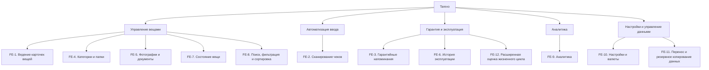

# Документ о концепции и границах кейса

| Поле | Значение |
|------|----------|
| Кейс | Tarevo — система учёта вещей, гарантий и истории эксплуатации |
| Индустриальный партнер | Не применяется — собственный проект автора |
| Версия | `0.1-draft` |
| Дата | 2026-11-20 |
| Статус | черновик |
| Авторы | Родионов Родион Дмитриевич |

## 1. Введение

Tarevo — мобильное приложение для централизованного учёта принадлежащих пользователю вещей, чеков, гарантийных документов и событий эксплуатации. Приложение позволяет создавать карточки вещей вручную или на основе распознанного чека, сохранять сведения о покупке и гарантии, фиксировать фотографии и историю событий, а также получать напоминания об окончании гарантийного срока.

Проект решает проблему разрозненного хранения информации о бытовой технике и других значимых вещах. Чеки, гарантийные талоны и сведения о ремонтах часто хранятся отдельно, теряются или становятся недоступны в момент обращения по гарантии. Пользователю также сложно отслеживать сроки гарантии и восстанавливать полную историю эксплуатации конкретной вещи.

Предлагаемое решение представляет собой мобильное приложение, ориентированное на локальное хранение пользовательских данных. Tarevo формирует единый цифровой паспорт вещи, объединяющий основные характеристики, сведения о покупке, гарантию, фотографии и последовательность событий жизненного цикла. Документ определяет концепцию продукта, требования и границы первого выпуска; наличие функции в целевой концепции не означает, что она уже реализована в программном коде.

## 2. Бизнес-контекст и цели

### 2.1. Исходные данные

В рамках кейса рассматривается ситуация, при которой сведения о принадлежащих пользователю вещах не объединены в одном месте. Бумажные чеки и гарантийные талоны могут храниться отдельно от фотографий, электронных документов и сведений о ремонтах. Данные о покупке, сроке гарантии и техническом состоянии вещи не образуют единую связанную историю.

Для проверки гарантийного статуса пользователю необходимо самостоятельно найти документы, определить дату покупки и рассчитать дату окончания гарантии. Сведения о ремонтах, обслуживании и изменении состояния также фиксируются несистемно либо не сохраняются. Это увеличивает время поиска информации и создаёт риск пропустить окончание гарантии или потерять документы, необходимые для обращения к продавцу или в сервисный центр.

К моменту подготовки концепции в проекте сформированы функциональные требования, информационная и техническая архитектура, модель локальной базы данных и программная основа мобильного приложения. В коде реализованы операции с карточками вещей, категориями, папками, фотографиями, результатами сканирования, событиями, настройками, валютами, гарантийными напоминаниями и базовой аналитикой. Пользовательский интерфейс находится на ранней стадии, поэтому наличие бизнес-логики в коде не означает готовность соответствующего пользовательского сценария.

Количественные показатели исходного процесса, включая среднее время поиска документов и долю пропущенных гарантийных сроков, пока не измерялись. Их базовые значения должны быть определены до проверки бизнес-эффекта приложения.

### 2.2. Возможности бизнеса

Создание единого цифрового паспорта вещи позволит пользователю быстрее находить сведения о покупке, гарантии и эксплуатации без поиска по отдельным бумажным и электронным источникам. Гарантийные напоминания снизят риск пропустить срок обращения, а сохранённые чеки и фотографии документов упростят подготовку необходимых сведений.

Сканирование чеков позволит сократить объём ручного ввода при создании карточек. Распознанные значения должны оставаться доступными для проверки и исправления пользователем, поскольку качество результата зависит от состояния изображения и формата конкретного чека. Объединение карточки, фотографий и временной шкалы событий создаст основу для анализа расходов на покупку, ремонт и обслуживание вещи.

Локальное хранение позволит использовать основные функции без постоянного подключения к сети и уменьшит зависимость от внешнего сервиса. В последующих выпусках единая структура данных может стать основой для резервного копирования, переноса данных между устройствами, формирования отчётов, передачи цифрового паспорта новому владельцу и более сложной оценки жизненного цикла. Эти возможности рассматриваются как направления развития и не включаются автоматически в первый выпуск.

### 2.3. Бизнес-цели

Целевые значения являются предварительными и должны быть проверены на пилотной группе. Базовые показатели BO-1 и BO-2 измеряются до начала пилота на одинаковом наборе контрольных задач.

| ID | Цель | Масштаб | Способ измерения | База | План | Обязательный порог | Срок |
|----|------|---------|------------------|------|------|--------------------|------|
| BO-1 | Сократить медианное время создания проверенной карточки вещи по чеку | Пользователи пилотной группы и чеки поддерживаемого качества | Сравнение времени ручного заполнения и сканирования с последующей проверкой на одном наборе чеков | Не измерена; фиксируется до пилота | Сокращение не менее чем на 50% | Сокращение не менее чем на 30% | К завершению пилота первого выпуска |
| BO-2 | Сократить медианное время поиска сведений о покупке и гарантии конкретной вещи | Карточки вещей, содержащие сохранённые сведения о покупке или документы | Выполнение одинакового набора задач до использования Tarevo и после заполнения карточек | Не измерена; фиксируется до пилота | Сокращение не менее чем на 70% | Сокращение не менее чем на 50% | В течение одного месяца после начала пилота |
| BO-3 | Обеспечить доступность сведений о покупке и гарантии для вещей, включённых в пилот | Вещи пилотной группы, для которых у пользователя имеются исходные документы или сведения | Проверка доли карточек, в которых сохранены и доступны имеющиеся сведения о покупке, гарантии и связанные изображения | 0% до переноса сведений в Tarevo | Не менее 95% подходящих вещей | Не менее 90% подходящих вещей | В течение одного месяца после начала пилота |

### 2.4. Видение решения

Для владельца бытовой техники и других значимых вещей, которому необходимо сохранять документы, отслеживать гарантийные сроки и вести историю эксплуатации, Tarevo — это мобильное приложение для создания и хранения цифровых паспортов вещей. Оно объединяет сведения о покупке, гарантию, фотографии, состояние и события жизненного цикла, а также помогает добавлять данные посредством распознавания чеков и получать гарантийные напоминания.

В отличие от разрозненного хранения бумажных чеков, фотографий и заметок, Tarevo связывает сведения с конкретной вещью и делает их доступными в единой карточке без обязательного постоянного подключения к внешнему сервису.

## 3. Стейкхолдеры

### 3.1. Профили заинтересованных лиц

Оценка отношения и интересов является предварительной, поскольку отдельные интервью со стейкхолдерами в рамках лабораторной работы не проводились.

| Заинтересованное лицо | Основная ценность | Отношение | Основные интересы | Ограничения |
|-----------------------|-------------------|-----------|-------------------|-------------|
| Пользователь - владелец вещей | Быстрый доступ к сведениям о покупке, гарантии, документах и истории эксплуатации | Предполагается высокая заинтересованность при простом вводе данных и понятной пользе | Удобное добавление вещей, сохранность документов, своевременные напоминания, поиск, конфиденциальность | Должен проверять распознанные данные, предоставлять разрешения на уведомления и располагать исходными документами |
| Владелец продукта Tarevo | Создание полезного и реализуемого продукта с контролируемыми границами первого выпуска | Заинтересован в развитии продукта и подтверждении его ценности | Соответствие функций потребностям пользователя, качество, безопасность данных, последовательное развитие | Ограниченные ресурсы проекта, отсутствие подтверждённых базовых метрик и необходимость приоритизации функций |
| Команда разработки Tarevo | Однозначные, проверяемые и технически реализуемые требования | Высокая заинтересованность в согласованной концепции | Чёткие бизнес-правила, тестируемые критерии, совместимость с архитектурой и отсутствие противоречий | Текущая стадия разработки, ограничения мобильной платформы и необходимость поддерживать локальную работу |
| Участник пилотного тестирования | Возможность проверить приложение на собственных вещах и повлиять на удобство первого выпуска | Отношение определяется результатами пилота | Понятные сценарии, корректное распознавание, возможность исправления ошибок, предсказуемые уведомления | Ограниченный набор тестовых вещей и чеков; результаты пилота могут не представлять всех пользователей |
| Продавец или сервисный центр | Получение от пользователя доступных сведений о покупке, гарантии и вещи при обращении | Нейтральное; является внешней стороной и не работает с приложением напрямую | Корректные даты, идентификация вещи и доступность подтверждающих документов | Собственные правила гарантийного обслуживания; отсутствие прямого доступа к данным Tarevo |

### 3.2. Матрица влияния / интереса

| Стейкхолдер | Влияние (низкое / среднее / высокое) | Интерес (низкий / средний / высокий) | Стратегия работы |
|-------------|--------------------------------------|--------------------------------------|------------------|
| Пользователь - владелец вещей | высокое | высокий | Проверять основные сценарии на пилотной группе, собирать обратную связь об удобстве и учитывать проблемы при определении приоритетов |
| Владелец продукта Tarevo | высокое | высокий | Согласовывать цели, границы выпусков, бизнес-правила и критерии приёмки |
| Команда разработки Tarevo | высокое | высокий | Проверять техническую реализуемость требований, поддерживать трассировку и оценивать влияние изменений |
| Участник пилотного тестирования | среднее | высокий | Предоставлять понятные тестовые сценарии, фиксировать результаты и разбирать обнаруженные проблемы |
| Продавец или сервисный центр | среднее | низкий | Учитывать внешние правила гарантийного обращения и состав необходимых документов без включения прямой интеграции в первый выпуск |

## 4. Функциональные требования

### 4.1. Основные функции

| ID | Функция | Краткое описание |
|----|---------|------------------|
| FE-1 | Ведение карточек вещей | Создание карточки вручную или из результата сканирования, просмотр, изменение и удаление сведений о вещи, покупке и гарантии |
| FE-2 | Сканирование чеков | Получение изображения чека с камеры, из галереи или файла, локальное распознавание данных и формирование черновиков карточек с возможностью ручной проверки |
| FE-3 | Гарантийные напоминания | Расчёт даты окончания гарантии, настройка порогов напоминаний и планирование локальных уведомлений |
| FE-4 | Категории и папки | Классификация вещей по категориям и размещение одной вещи в нескольких пользовательских папках |
| FE-5 | Фотографии и документы | Добавление, просмотр, замена, удаление и упорядочивание связанных с вещью изображений |
| FE-6 | История эксплуатации | Ведение временной шкалы покупок, ремонтов, обслуживания, замен деталей, поломок, продаж, потерь, утилизации и заметок |
| FE-7 | Состояние вещи | Хранение и изменение текущего состояния: `new`, `good`, `satisfactory`, `damaged`, `broken` или `under_repair` |
| FE-8 | Поиск, фильтрация и сортировка | Поиск вещей и отбор списка по основным характеристикам, категории, гарантии и состоянию |
| FE-9 | Аналитика | Формирование сводок по количеству вещей, стоимости покупок, категориям, состояниям, гарантиям и расходам на ремонт и обслуживание |
| FE-10 | Настройки и валюты | Управление темой, языком, уведомлениями, основной валютой и пересчётом денежных значений |
| FE-11 | Перенос и резервное копирование данных | Экспорт, импорт и создание резервной копии карточек, событий, фотографий и настроек |
| FE-12 | Расширенная оценка жизненного цикла | Расчёт остаточной стоимости и формирование рекомендации о продолжении эксплуатации или планировании замены |

### 4.2. Дерево функций

### 4.3. Пользовательские истории / варианты использования

Основным действующим лицом является пользователь - владелец вещей. Варианты UC-9 и UC-10 относятся к направлениям последующих выпусков.

| Основное действующее лицо | Варианты использования |
|---------------------------|------------------------|
| Пользователь - владелец вещей | UC-1. Добавление вещи по чеку; UC-2. Добавление вещи вручную; UC-3. Просмотр и изменение карточки вещи; UC-4. Организация и поиск вещей; UC-5. Добавление события эксплуатации; UC-6. Просмотр гарантийных напоминаний; UC-7. Просмотр аналитики; UC-8. Изменение настроек и основной валюты; UC-9. Экспорт, импорт и резервное копирование данных; UC-10. Просмотр оценки жизненного цикла |

### 4.4. Детальный сценарий (минимум один)

#### UC-1. Добавление вещи по чеку

| Поле | Значение |
|------|----------|
| Автор / дата | Родионов Родион Дмитриевич / 2026-11-20 |
| Основное действующее лицо | Пользователь - владелец вещей |
| Дополнительные действующие лица | Системные сервисы камеры, галереи и файлов; локальный модуль распознавания; локальная база данных; сервис уведомлений |
| Описание | Пользователь получает изображение чека, проверяет распознанные сведения и создаёт одну или несколько карточек вещей |
| Условие-триггер | Пользователь хочет добавить в Tarevo вещь, сведения о которой присутствуют в чеке |
| Предварительные условия | PRE-1. Приложение запущено, локальная база данных доступна. PRE-2. Пользователь предоставил разрешение на выбранный источник изображения. PRE-3. Изображение чека доступно на устройстве или может быть получено камерой |
| Выходные условия | POST-1. Результат сканирования сохранён. POST-2. Для выбранных позиций созданы карточки вещей со ссылкой на исходное сканирование. POST-3. При наличии корректных гарантийных данных и включённых уведомлений запланированы гарантийные напоминания |
| Приоритет | высокий |
| Частота использования | При добавлении новой вещи после покупки или при переносе имеющегося чека в приложение |
| Бизнес-правила | BR-1, BR-2, BR-3, BR-4, BR-5, BR-6, BR-7 |

**Нормальное направление**

1. Пользователь выбирает добавление вещи по чеку.
2. Система предлагает получить изображение с камеры, из галереи или из файла.
3. Пользователь выбирает источник и предоставляет изображение чека.
4. Система выполняет локальное распознавание изображения и доступных данных QR-кода.
5. Система извлекает сведения о магазине, дате покупки, сумме, валюте и товарных позициях, сохраняя признаки неуверенного распознавания.
6. Система показывает изображение чека, распознанные сведения, предупреждения и найденные товарные позиции.
7. Пользователь проверяет общие данные чека, исправляет ошибки и дополняет отсутствующие сведения.
8. Пользователь выбирает одну или несколько товарных позиций для создания карточек.
9. Пользователь проверяет и при необходимости изменяет название, категорию, бренд, модель, серийный номер, цену и гарантийные сведения каждой выбранной позиции.
10. Пользователь подтверждает создание карточек.
11. Система проверяет обязательные поля и согласованность введённых значений.
12. Система сохраняет результат сканирования и создаёт карточку для каждой выбранной позиции, связывая её с исходным сканированием.
13. Если для вещи определена дата окончания гарантии и уведомления разрешены, система планирует гарантийные напоминания.
14. Система показывает количество созданных карточек и предлагает открыть список вещей.

**Альтернативные направления**

- **1.1. Ручное добавление.** На шаге 1 пользователь выбирает ввод без чека. Система переходит к UC-2 «Добавление вещи вручную».
- **3.1. Выбор из галереи или файла.** Вместо камеры пользователь выбирает существующее локальное изображение или поддерживаемый файл.
- **4.1. Обнаружен QR-код.** Система использует доступные данные QR-кода для дополнения и проверки распознанных даты, суммы и фискальных реквизитов.
- **6.1. Найдено несколько товарных позиций.** Пользователь выбирает нужные позиции и может отказаться от создания карточек для остальных.
- **7.1. Данных недостаточно.** Пользователь вручную заполняет обязательные сведения и при необходимости добавляет товарную позицию.
- **12.1. Хранение исходных чеков отключено.** Система сохраняет распознанный текст и структурированный результат без постоянного хранения исходного изображения.

**Исключения**

- **1.0.E1. Нет разрешения на камеру или файлы.** Система сообщает о недоступности выбранного источника и предлагает предоставить разрешение либо выбрать другой способ добавления.
- **1.0.E2. Изображение не удалось прочитать.** Система не создаёт вымышленные значения, показывает ошибку распознавания и предлагает заменить изображение или перейти к ручному вводу.
- **1.0.E3. Распознана только часть сведений.** Система показывает частичный результат, выделяет предупреждения и позволяет пользователю заполнить пропущенные поля.
- **1.0.E4. Данные QR-кода и напечатанного чека расходятся.** Система показывает предупреждение и требует проверки пользователем перед сохранением.
- **1.0.E5. Введены некорректные значения.** Система указывает проблемные поля и не сохраняет соответствующую карточку до исправления.
- **1.0.E6. Позиция этого сканирования уже была использована.** Система предотвращает повторное создание карточки для той же товарной позиции.
- **1.0.E7. Не удалось сохранить результат.** Система сообщает об ошибке и не обозначает не сохранённую карточку как созданную.
- **1.0.E8. Уведомления запрещены.** Карточка сохраняется, но система сообщает, что гарантийные напоминания не будут запланированы.

**Другая информация**

- **BR-1.** Распознанные значения являются черновиком до подтверждения пользователем.
- **BR-2.** Название вещи обязательно. Неизвестные значения остаются незаполненными и не заменяются вымышленными данными или нулями.
- **BR-3.** Одна товарная позиция одного результата сканирования может быть связана не более чем с одной карточкой вещи.
- **BR-4.** Цена покупки не может быть отрицательной. Цена и валюта указываются совместно.
- **BR-5.** Срок гарантии не может быть отрицательным, а дата окончания гарантии не может предшествовать дате покупки.
- **BR-6.** Исходное изображение чека сохраняется постоянно только при включённой соответствующей настройке.
- **BR-7.** Ошибка или запрет уведомлений не должны препятствовать сохранению карточки вещи.
- Один чек может содержать несколько товарных позиций и приводить к созданию нескольких карточек.
- Для выполнения локального распознавания постоянное подключение к сети не требуется.

**Предположения**

- Пользователь имеет право хранить выбранное изображение и содержащиеся в нём сведения.
- Изображение имеет поддерживаемый формат и доступно приложению.
- Пользователь проверяет распознанные значения перед созданием карточек.
- Устройство располагает достаточными ресурсами для локальной обработки изображения.

### 4.5. Сжатые сценарии (по образцу Вигерса)

Остальные UC можно описать короче, если ключевая информация уже есть в другом источнике.

#### UC-n. _Название_

- Описание:
- Исключения:
- Приоритет:
- Бизнес-правила:
- Другая информация:

## 5. Нефункциональные требования

| ID | Категория | Требование | Метрика / порог |
|----|-----------|------------|-----------------|
| NFR-P1 | Производительность | | |
| NFR-A1 | Доступность | | |
| NFR-S1 | Безопасность | | |
| NFR-C1 | Совместимость / IT-ландшафт | | |
| NFR-U1 | Удобство использования | | |

## 6. Границы кейса

### 6.1. In Scope

- …

### 6.2. Out of Scope

- …

### 6.3. Состав первого и последующих выпусков

| Функция | Выпуск 1 | Выпуск 2 | Выпуск 3 |
|---------|----------|----------|----------|
| FE-1 | | | |
| FE-2 | | | |

## 7. Ограничения и допущения

### 7.1. Ограничения и исключения

| ID | Формулировка |
|----|--------------|
| LI-1 | |

### 7.2. Предположения и зависимости

| ID | Тип | Формулировка |
|----|-----|--------------|
| AS-1 | допущение | |
| DE-1 | зависимость | |

### 7.3. Приоритеты проекта

| Область | Ограничения | Движущая сила | Степень свободы |
|---------|-------------|---------------|-----------------|
| Функции | | | |
| Качество | | | |
| Сроки | | | |
| Расходы | | | |
| Персонал | | | |

### 7.4. Особенности развертывания

Стек, инфраструктура, обучение пользователей, необходимые изменения смежных систем.

## 8. Риски

| ID | Риск | Вероятность (0–1) | Ущерб (1–10) | Митигация |
|----|------|-------------------|--------------|-----------|
| RI-1 | | | | |

> [!WARNING]
> Риски, которые могут сорвать приемку выпуска 1, вынесите сюда явно.

## 9. Критерии приемки

| ID | Критерий | Как проверяется | Порог | Срок |
|----|----------|-----------------|-------|------|
| SM-1 | | | | |
| AC-1 | | | | |

Партнер принимает работу, если выполнены все критерии со статусом «обязательный» и закрыты In Scope функции выпуска 1.
