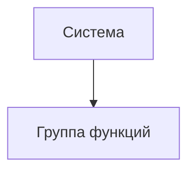

# Документ о концепции и границах кейса

| Поле | Значение |
|------|----------|
| Кейс | Tarevo — система учёта вещей, гарантий и истории эксплуатации |
| Индустриальный партнер | Не применяется — собственный проект автора |
| Версия | `0.1-draft` |
| Дата | 2026-11-20 |
| Статус | черновик |
| Авторы | Родионов Родион Дмитриевич |

## 1. Введение

Tarevo — мобильное приложение для централизованного учёта принадлежащих пользователю вещей, чеков, гарантийных документов и событий эксплуатации. Приложение позволяет создавать карточки вещей вручную или на основе распознанного чека, сохранять сведения о покупке и гарантии, фиксировать фотографии и историю событий, а также получать напоминания об окончании гарантийного срока.

Проект решает проблему разрозненного хранения информации о бытовой технике и других значимых вещах. Чеки, гарантийные талоны и сведения о ремонтах часто хранятся отдельно, теряются или становятся недоступны в момент обращения по гарантии. Пользователю также сложно отслеживать сроки гарантии и восстанавливать полную историю эксплуатации конкретной вещи.

Предлагаемое решение представляет собой мобильное приложение, ориентированное на локальное хранение пользовательских данных. Tarevo формирует единый цифровой паспорт вещи, объединяющий основные характеристики, сведения о покупке, гарантию, фотографии и последовательность событий жизненного цикла. Документ определяет концепцию продукта, требования и границы первого выпуска; наличие функции в целевой концепции не означает, что она уже реализована в программном коде.

## 2. Бизнес-контекст и цели

### 2.1. Исходные данные

В рамках кейса рассматривается ситуация, при которой сведения о принадлежащих пользователю вещах не объединены в одном месте. Бумажные чеки и гарантийные талоны могут храниться отдельно от фотографий, электронных документов и сведений о ремонтах. Данные о покупке, сроке гарантии и техническом состоянии вещи не образуют единую связанную историю.

Для проверки гарантийного статуса пользователю необходимо самостоятельно найти документы, определить дату покупки и рассчитать дату окончания гарантии. Сведения о ремонтах, обслуживании и изменении состояния также фиксируются несистемно либо не сохраняются. Это увеличивает время поиска информации и создаёт риск пропустить окончание гарантии или потерять документы, необходимые для обращения к продавцу или в сервисный центр.

К моменту подготовки концепции в проекте сформированы функциональные требования, информационная и техническая архитектура, модель локальной базы данных и программная основа мобильного приложения. В коде реализованы операции с карточками вещей, категориями, папками, фотографиями, результатами сканирования, событиями, настройками, валютами, гарантийными напоминаниями и базовой аналитикой. Пользовательский интерфейс находится на ранней стадии, поэтому наличие бизнес-логики в коде не означает готовность соответствующего пользовательского сценария.

Количественные показатели исходного процесса, включая среднее время поиска документов и долю пропущенных гарантийных сроков, пока не измерялись. Их базовые значения должны быть определены до проверки бизнес-эффекта приложения.

### 2.2. Возможности бизнеса

Что изменится, если решение появится; какие смежные возможности откроются позже.

### 2.3. Бизнес-цели

| ID | Цель | Масштаб | Способ измерения | База | План | Обязательный порог | Срок |
|----|------|---------|------------------|------|------|--------------------|------|
| BO-1 | | | | | | | |
| BO-2 | | | | | | | |
| BO-3 | | | | | | | |

### 2.4. Видение решения

Одно-два предложения в формате: *для [пользователь], который [потребность], [имя системы] — это [тип продукта], который [ключевые возможности]. В отличие от [альтернатива], решение [отличие]*.

## 3. Стейкхолдеры

### 3.1. Профили заинтересованных лиц

| Заинтересованное лицо | Основная ценность | Отношение | Основные интересы | Ограничения |
|-----------------------|-------------------|-----------|-------------------|-------------|
| | | | | |

### 3.2. Матрица влияния / интереса

| Стейкхолдер | Влияние (низкое / среднее / высокое) | Интерес (низкий / средний / высокий) | Стратегия работы |
|-------------|--------------------------------------|--------------------------------------|------------------|
| | | | |

## 4. Функциональные требования

### 4.1. Основные функции

| ID | Функция | Краткое описание |
|----|---------|------------------|
| FE-1 | | |
| FE-2 | | |

### 4.2. Дерево функций

### 4.3. Пользовательские истории / варианты использования

| Основное действующее лицо | Варианты использования |
|---------------------------|------------------------|
| | |

### 4.4. Детальный сценарий (минимум один)

#### UC-1. _Название_

| Поле | Значение |
|------|----------|
| Автор / дата | |
| Основное действующее лицо | |
| Дополнительные действующие лица | |
| Описание | |
| Условие-триггер | |
| Предварительные условия | PRE-1. |
| Выходные условия | POST-1. |
| Приоритет | высокий / средний / низкий |
| Частота использования | |
| Бизнес-правила | BR-… |

**Нормальное направление**

1.
2.

**Альтернативные направления**

- 1.1 …

**Исключения**

- 1.0.E1 …

**Другая информация**

-

**Предположения**

-

### 4.5. Сжатые сценарии (по образцу Вигерса)

Остальные UC можно описать короче, если ключевая информация уже есть в другом источнике.

#### UC-n. _Название_

- Описание:
- Исключения:
- Приоритет:
- Бизнес-правила:
- Другая информация:

## 5. Нефункциональные требования

| ID | Категория | Требование | Метрика / порог |
|----|-----------|------------|-----------------|
| NFR-P1 | Производительность | | |
| NFR-A1 | Доступность | | |
| NFR-S1 | Безопасность | | |
| NFR-C1 | Совместимость / IT-ландшафт | | |
| NFR-U1 | Удобство использования | | |

## 6. Границы кейса

### 6.1. In Scope

- …

### 6.2. Out of Scope

- …

### 6.3. Состав первого и последующих выпусков

| Функция | Выпуск 1 | Выпуск 2 | Выпуск 3 |
|---------|----------|----------|----------|
| FE-1 | | | |
| FE-2 | | | |

## 7. Ограничения и допущения

### 7.1. Ограничения и исключения

| ID | Формулировка |
|----|--------------|
| LI-1 | |

### 7.2. Предположения и зависимости

| ID | Тип | Формулировка |
|----|-----|--------------|
| AS-1 | допущение | |
| DE-1 | зависимость | |

### 7.3. Приоритеты проекта

| Область | Ограничения | Движущая сила | Степень свободы |
|---------|-------------|---------------|-----------------|
| Функции | | | |
| Качество | | | |
| Сроки | | | |
| Расходы | | | |
| Персонал | | | |

### 7.4. Особенности развертывания

Стек, инфраструктура, обучение пользователей, необходимые изменения смежных систем.

## 8. Риски

| ID | Риск | Вероятность (0–1) | Ущерб (1–10) | Митигация |
|----|------|-------------------|--------------|-----------|
| RI-1 | | | | |

> [!WARNING]
> Риски, которые могут сорвать приемку выпуска 1, вынесите сюда явно.

## 9. Критерии приемки

| ID | Критерий | Как проверяется | Порог | Срок |
|----|----------|-----------------|-------|------|
| SM-1 | | | | |
| AC-1 | | | | |

Партнер принимает работу, если выполнены все критерии со статусом «обязательный» и закрыты In Scope функции выпуска 1.
